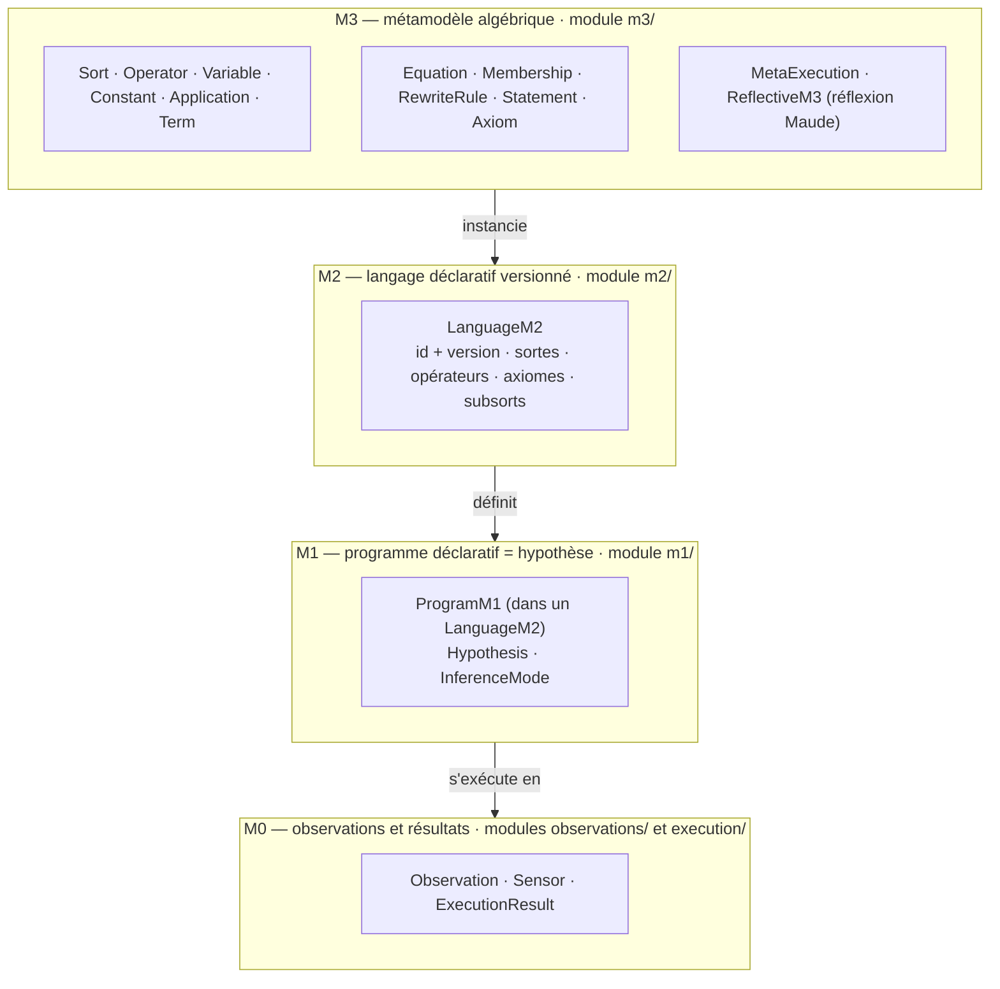

# Architecture cible — SDK épistémique

Ce document décrit l'**architecture cible** du SDK épistémique : la boucle épistémologique complète et la pile de méta-modélisation M3 → M0. Sources : `AGENTS.md`, `docs/architecture/OVERVIEW.md`, `docs/architecture/DECISIONS.md`.

> **État actuel** : seules les **interfaces** (`typing.Protocol` + `dataclass(frozen=True)`) sont livrées ; aucune implémentation (interpréteur M3/Maude, synthèse, exécuteur, solveurs) n'existe encore. Ce document montre la **cible** à atteindre.

## 1. Boucle épistémologique

```
Sensor → Observation → BeliefGraph → InferenceEngine → Hypothesis
  → ProgramTransformation → Executor → ResultTransformation → ExecutionResult
  → Validator → KnowledgeReviser → KnowledgeBase → itération
```



```mermaid
flowchart LR
    %% ── observations (M0) ──
    subgraph OBS["observations · M0"]
        Sensor["Sensor"]
        Observation["Observation"]
    end

    %% ── beliefs ──
    subgraph BEL["beliefs"]
        BeliefGraph["BeliefGraph<br/>Belief · Relation · BeliefUpdater"]
    end

    %% ── inference ──
    subgraph INF["inference"]
        InferenceEngine["InferenceEngine<br/>abduction · induction · déduction"]
    end

    %% ── m1 (M1) ──
    subgraph M1["m1 · M1"]
        Hypothesis["Hypothesis<br/>= ProgramM1"]
    end

    %% ── execution ──
    subgraph EXE["execution"]
        ProgramTransformation["ProgramTransformation"]
        Executor["Executor"]
        ResultTransformation["ResultTransformation"]
        ExecutionResult["ExecutionResult · M0"]
    end

    %% ── validation ──
    subgraph VAL["validation"]
        Validator["Validator"]
        ValidationReport["ValidationReport"]
    end

    %% ── knowledge ──
    subgraph KNO["knowledge"]
        KnowledgeReviser["KnowledgeReviser"]
        KnowledgeBase["KnowledgeBase"]
    end

    Sensor --> Observation
    Observation --> BeliefGraph
    BeliefGraph --> InferenceEngine
    InferenceEngine --> Hypothesis
    Hypothesis --> ProgramTransformation
    ProgramTransformation --> Executor
    Executor --> ResultTransformation
    ResultTransformation --> ExecutionResult
    ExecutionResult --> Validator
    Observation -.->|"observations indépendantes<br/>(pas de fuite train/test)"| Validator
    Validator --> ValidationReport
    ValidationReport --> KnowledgeReviser
    KnowledgeReviser --> KnowledgeBase
    KnowledgeBase -.->|"connaissances antérieures"| InferenceEngine
    KnowledgeBase -.->|"itération"| Sensor
```

`EpistemicEngine` (module `engine/`) orchestre un cycle complet de cette boucle : `step(observations) → Sequence[ValidationReport]`, et expose `beliefs` et `knowledge` comme état observable.

## 2. Pile de méta-modélisation M3 → M0



## 3. Invariants structurants

1. Une hypothèse est un **programme déclaratif** (`ProgramM1`), pas une proposition textuelle.
2. Un programme est défini **relativement à un `LanguageM2`** (identifiant + version).
3. Une **observation** n'est pas nécessairement vraie ; une **croyance** n'est pas une **connaissance**.
4. Un **axiome** admis dans une théorie n'est pas une hypothèse corroborée empiriquement.
5. **Transformation de programme ≠ transformation de résultat** (deux étapes distinctes).
6. La **validation** confronte des résultats d'exécution à des observations **indépendantes** (aucune fuite entraînement/test).
7. Toute connaissance **préserve la provenance** de ses hypothèses, exécutions et validations.
8. Une connaissance reste **révisable** en présence de nouveaux contre-exemples.

## Voir aussi

- `docs/architecture/DEPENDENCIES.md` — graphe orienté « dépend de » entre modules.
- `docs/architecture/OVERVIEW.md` — vue d'ensemble textuelle.
- `docs/architecture/DECISIONS.md` — journal des décisions (ADR).
- `AGENTS.md` — carte des modules par agent et invariants.
