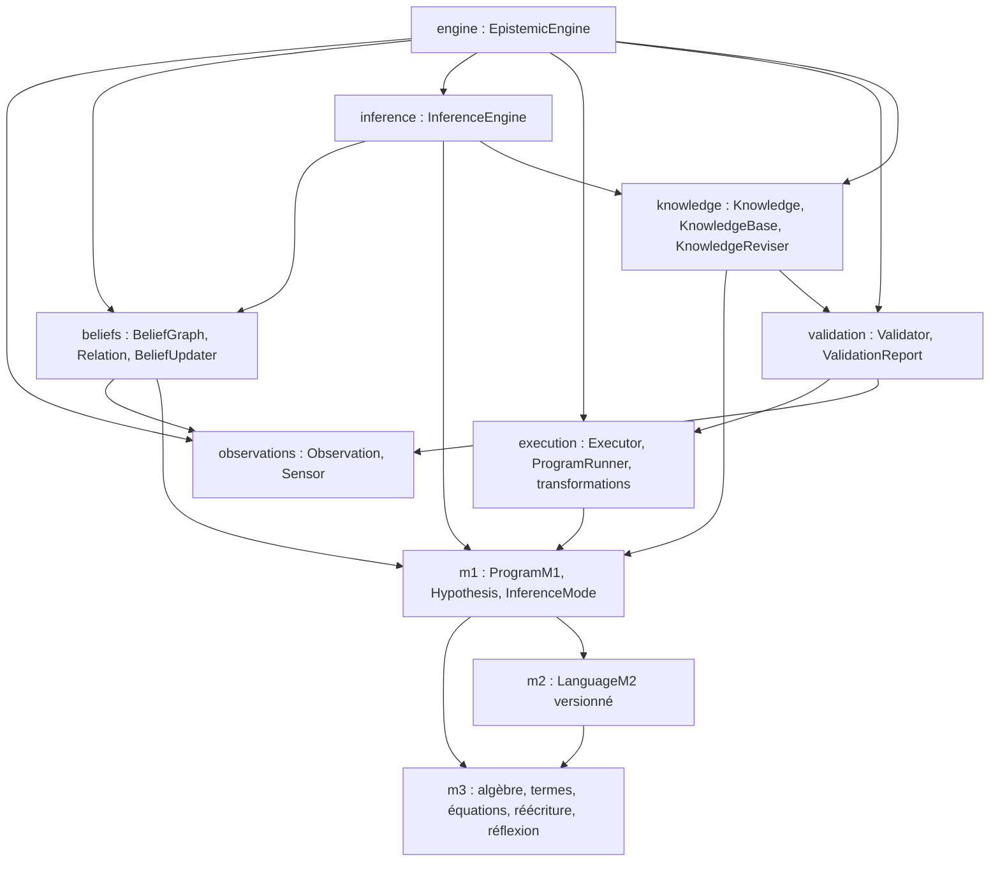

# Dépendances entre modules

Graphe orienté « dépend de » (une flèche A → B signifie que A importe/utilise B).

## Règles de dépendance

- M3 est la base : aucun module ne dépend de M3 et M3 ne dépend de rien d'autre.
- M2 et M1 dépendent de M3 ; M1 référence un `LanguageM2`.
- Le flux de la boucle suit : `observations → beliefs → inference → execution → validation → knowledge → engine`.
- `engine` intègre tout ; personne ne dépend de `engine`.
- `inference` produit des hypothèses M1 et lit la base de connaissance ; il ne modifie pas `m2`.

## Import map (état actuel)

| Module importe | Dépend de |
|---|---|
| `m2/language_m2.py` | `m3` (axiom, operator, sort) |
| `m1/program_m1.py` | `m3` (term, rewrite_rule) |
| `beliefs/*` | `observations`, `m1` |
| `inference/inference_engine.py` | `beliefs`, `knowledge`, `m1` |
| `execution/*` | `m1`, `observations` (via ExecutionContext) |
| `validation/*` | `execution`, `observations` |
| `knowledge/*` | `m1`, `validation` |
| `engine/epistemic_engine.py` | `observations`, `beliefs`, `knowledge`, `m1`, `validation` |

## Coordination inter-agents

Depuis ADR-007, `algorithms/arc_language.py` compose `LanguageM2`, la taxonomie et les primitives de grille internes. `algorithms/taxonomic_solver.py` réutilise `LanguageDiscovery.fit` et la recherche typée. Les adaptateurs `examples/arc/` importent ces algorithmes ; aucun algorithme n'importe les exemples. `examples/arc/loader.py` réexporte `Grid`. Le harness d'expérience utilise les contrats d'hypothèse, exécution et validation sans les modifier.

- `execution/` est partagé entre **transformations** (`*_transformation*.py`, `transformation_pipeline.py`) et **execution** (`executor.py`, `program_runner.py`) : toute écriture croisée y est coordonnée par l'architecte.
- Toute dépendance nouvelle ou supprimée doit être reportée ici et dans `DECISIONS.md`.
